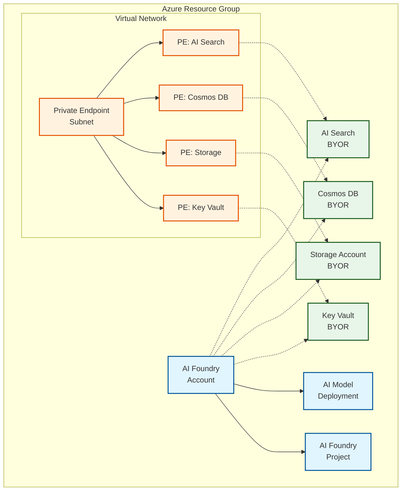

# Private with BYOR example

This deploys the module with VNet injection and Bring Your Own Resources (BYOR) services.

## VNet-injected Agent Service regression

This runnable example exercises standard Agent Service with a subnet delegated to
`Microsoft.App/environments` and BYO Storage, Cosmos DB, and Search connections.
It reuses the private BYOR infrastructure rather than maintaining a second copy.
Existing subnet, private endpoint, DNS, identity, and RBAC settings are unchanged.
The module supplies the project identity's connection permissions and RBAC
propagation wait before creating the project capability host.

The regression is explicit provisioning of a missing **account** capability
host with the injected subnet in `properties.customerSubnet`. The example
defaults `create_account_capability_host` to false, preserving platform ownership.
Only set it to true after confirming the account is fully provisioned and has
no existing or provisioning host. Network injection can auto-create a host;
the opt-in must not create a second one. This example does not discover or
adopt existing hosts.

With the opt-in enabled, the project already depends on the managed account
host. `agent_capability_host_ids` blocks a missing managed account ID and a
missing project ID; with the default, the account ID is null because the
platform host is not managed here. Unknown IDs are checked during apply.
These checks do not prove Azure readiness or successful agent execution.

Despite the historical example name, it is not a private-only reference:
`create_private_endpoints` remains false for Foundry, Search public access and
local authentication remain enabled, and Storage retains its existing access
defaults. Connected-service private endpoints and DNS links are still present.
The regression adds no network-policy changes or module-wide dependency edges.
Review that existing posture before approving a deployment.

From the repository root, run local provider-mocked coverage without Azure writes:

```powershell
avm test unit
```

`tests/unit/private_byor_example.tftest.hcl` runs this example as an alternate
test module. It retains the real Foundry and project modules, mocks providers,
and overrides unrelated supporting modules. It checks both host outputs,
delegation, private endpoint DNS wiring, and BYO selections. The companion
`tests/unit/agent_capability_hosts.tftest.hcl` checks injection propagation and
the disabled-agent and non-injected paths. Two negative example runs deliberately
omit each host output in turn and require its output precondition to fail.
Mocked execution cannot establish Azure's actual creation order.

After separately approving an Azure test subscription, permissions, region,
model quota, cost, and cleanup scope, run the real deployment:

```powershell
avm test e2e --example private-byor
```

To exercise the explicit-provisioning regression, supply
`TF_VAR_create_account_capability_host=true` only in an authorized test scope
where the absent-host precondition has been established. A fresh injected
account can auto-create a host, in which case leave the opt-in disabled.
Do not treat this opt-in as a universally applicable fresh-deployment setting.

E2E applies the example, checks a no-change plan, and destroys it. Successful
creation of both hosts exercises Azure's account-before-project prerequisite;
inspect the output IDs and deployment log. The example includes a Windows VM
and Bastion and has a 20-minute destroy cooldown for the agent subnet association.
Do not run E2E merely to execute the mocked regression. No real-Azure result or
state-backed upgrade verification is implied by the local checks.

The Windows VM uses the naming module's `virtual_machine_windows` variant for its guest computer name, which is limited to 15 characters. Its Azure resource name uses the separate `compute_virtual_machine` variant.

Local authentication is disabled for the Foundry account and Cosmos DB, and public network access is disabled for Cosmos DB and Key Vault. The Bastion public IP preserves the Azure-managed `FirstPartyUsage` IP tag when Azure injects it; other IP tags remain managed by Terraform.

## Architecture

This example demonstrates VNet injection and connected-service private endpoints with custom Key Vault, Storage, Cosmos DB, and AI Search:



**Components:**
- AI Foundry Account with GPT-4 model deployment
- AI Foundry Project for development workspace
- Private endpoints for connected services; the Foundry private endpoint remains disabled
- BYOR: Key Vault, Storage Account, Cosmos DB, AI Search
