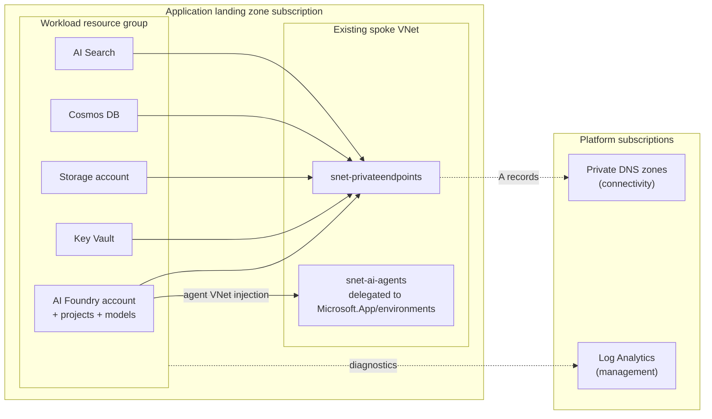

# Azure AI Foundry on an existing Enterprise-Scale Landing Zone

Terraform configuration that deploys Azure AI Foundry and its required dependent services
into an **application landing zone that already has networking**, using the Azure Verified
Module [`Azure/avm-ptn-aiml-ai-foundry/azurerm`](https://registry.terraform.io/modules/Azure/avm-ptn-aiml-ai-foundry/azurerm)
pinned to **v0.11.3**.

**New here?** Jump to [Usage](#usage). **Hit an error?** See
[TROUBLESHOOTING.md](TROUBLESHOOTING.md).

It is modelled on the module's `standard-private-byor` example, with the example's self-contained
lab networking (VNet, subnets, private DNS zones, Bastion, jump VM, Log Analytics) replaced by
**references to resources the platform already owns**.

## What it deploys

| Owned by this configuration | Notes |
| --- | --- |
| Resource group (optional) | Created in the application landing zone subscription, or reused. |
| Delegated agent subnet (optional) | Only when the platform team has not pre-created it. Delegated to `Microsoft.App/environments`. |
| Key Vault (optional) | Private endpoint, public access disabled, RBAC authorization. |
| Storage account | Agent file storage. Blob private endpoint, public access disabled, shared keys disabled. |
| Cosmos DB account | Agent thread storage. SQL private endpoint, public access disabled, local auth disabled. |
| Azure AI Search | Vector store. `searchService` private endpoint, public access disabled, Entra-ID-only by default. |
| AI Foundry account | AVM pattern module. Private endpoint, public access disabled, Entra-ID-only. |
| AI Foundry projects | Connected to the BYOR Storage / Cosmos DB / AI Search, with the data-plane RBAC the Standard Agent setup needs. |
| Model deployments | `gpt-4.1` and `text-embedding-3-large` by default. |
| Azure AI Video Indexer (optional) | Off by default. Video analysis over existing footage. Adds a dedicated storage account, a user-assigned identity and an `account` private endpoint. See [Video Indexer](#optional-azure-ai-video-indexer). |
| Diagnostic settings | Sent to an existing Log Analytics workspace, when one is supplied. |
| Private DNS zones (optional) | **Sandbox only.** Seven `privatelink.*` zones plus VNet links, when `create_private_dns_zones = true`. Eight with Video Indexer enabled. |

| Consumed, never created | Supplied as variables |
| --- | --- |
| Spoke virtual network, private endpoint subnet, NSGs, route tables, hub peering | `private_endpoint_subnet_resource_id` |
| Delegated agent subnet, when the platform owns it | `agent_subnet.resource_id` |
| Platform private DNS zones in the connectivity subscription | `private_dns_zone_resource_group_id` / `private_dns_zone_resource_ids` |
| Log Analytics workspace in the management subscription | `log_analytics_workspace_resource_id` |

## Why BYOR

The pattern module is deployed with `create_byor = false`. The dependent data services are created
by this configuration and passed in by resource ID. This is the module's documented production
path: the data services keep their own lifecycle, naming and policy posture, they survive a
`terraform destroy` of the Foundry stack, and they can be shared across projects.

## Architecture



## Prerequisites

1. **Terraform** >= 1.12 and an identity with `Owner` (or `Contributor` + `User Access Administrator`)
   on the application landing zone subscription. Role assignments are created on the Foundry account,
   Storage, Cosmos DB and AI Search.
2. **Registered resource providers** on the subscription: `Microsoft.CognitiveServices`,
   `Microsoft.Search`, `Microsoft.DocumentDB`, `Microsoft.KeyVault`, `Microsoft.Storage`,
   `Microsoft.Network`, and - required by the agent capability host - **`Microsoft.App`** and
   **   `Microsoft.ContainerService`**. See [Step 5](#step-5---register-resource-providers).
3. **A supported region.** The Foundry Agent Service supports private VNet injection in a
   [subset of regions](https://learn.microsoft.com/azure/ai-foundry/agents/concepts/limits-quotas-regions)
   only, and the Foundry account must be in the **same region as the VNet** that holds the agent
   subnet. `var.location` is validated against the supported list. Note that `westus2` is not
   supported.
4. **Spoke networking already in place**, with a private endpoint subnet that has
   `private_endpoint_network_policies` set to `Disabled`.
5. **A delegated agent subnet** for the Standard Agent setup, in the **same VNet** as the private
   endpoint subnet. It must be delegated to `Microsoft.App/environments`, be empty, and not be
   shared with any other workload. A `/24` is the recommended size. Either pre-create it or let
   this configuration create it (`agent_subnet.create = true`).
6. **Private DNS**, one of:
   - the platform zones exist and you have `Private DNS Zone Contributor` (or at least
     `Microsoft.Network/privateDnsZones/join/action`) on them, or
   - an Azure Policy DeployIfNotExists / Modify assignment registers private endpoint A records, in
     which case set `manage_private_dns_zone_groups = false` and no zone IDs are needed, or
   - **sandbox only**, there is no hub at all and you let this configuration create the zones with
     `create_private_dns_zones = true`.

   Zones required when this configuration manages the zone groups:

   | Key | Zone |
   | --- | --- |
   | `openai` | `privatelink.openai.azure.com` |
   | `cognitiveservices` | `privatelink.cognitiveservices.azure.com` |
   | `ai_services` | `privatelink.services.ai.azure.com` |
   | `blob` | `privatelink.blob.core.windows.net` |
   | `vault` | `privatelink.vaultcore.azure.net` |
   | `cosmos_sql` | `privatelink.documents.azure.com` |
   | `search` | `privatelink.search.windows.net` |
   | `video_indexer` | `privatelink.api.videoindexer.ai` (only when `deploy_video_indexer = true`) |

7. **Model quota** in the target region for the deployments in `ai_model_deployments`. If you have
   none, set `ai_model_deployments = {}` and add models later - see
   [TROUBLESHOOTING.md](TROUBLESHOOTING.md).
8. **Policy exemptions** if your ALZ denies public network access toggles or requires
   customer-managed keys. Everything here is deployed private by default, but CMK is not enabled.

## Deployment checklist

A condensed view of the whole process. Each item links to the section that explains it.

### Before you deploy

| # | Do this | Why it matters |
| --- | --- | --- |
| 1 | Confirm you have `Owner`, or `Contributor` + `User Access Administrator`, on the subscription | Role assignments are created on Foundry, Storage, Cosmos DB and AI Search. `Contributor` alone fails late in the apply. |
| 2 | [Pick a supported region](#step-1---pick-a-region) | The Agent Service supports private VNet injection in a subset of regions only. `var.location` is validated, so a bad region fails at plan time. |
| 3 | [Verify the private endpoint subnet](#step-2---confirm-your-networking) has `privateEndpointNetworkPolicies = Disabled` | Private endpoint creation fails otherwise. |
| 4 | Identify a free `/24` for the agent subnet **in the same VNet** | The Foundry account must sit in the same region and VNet as the agent subnet. |
| 5 | Decide your [DNS model](#landing-zone-where-the-platform-owns-dns-via-policy) - platform zones, policy-managed, or workload-created | This is the single most common source of "it deployed but nothing resolves". |
| 6 | [Check model quota](#step-3---check-model-quota) in the target region | No quota is not a blocker - deploy with `ai_model_deployments = {}` and add models later. |
| 7 | [Register resource providers](#step-5---register-resource-providers), especially `Microsoft.App` and `Microsoft.ContainerService` | Missing providers fail the capability host ~40 minutes into the apply. |
| 8 | Confirm Azure Policy will not block the deployment | Deny rules on public network access, regions or CMK surface as `RequestDisallowedByPolicy`. |
| 9 | Copy `terraform.tfvars.example` to `terraform.tfvars` and replace **every** placeholder | `terraform.tfvars` is gitignored. Never commit it. |

### During deployment

| Do this | Notes |
| --- | --- |
| Review the plan before applying | A first run should be `N to add, 0 to change, 0 to destroy`. Any destroy on a first apply means something is wrong - stop. |
| Budget **30-60 minutes** | AI Search alone is 10-15 min, and there is a hard-coded 5 minute wait after the Foundry account is created that prints nothing. |
| Watch for `Still creating... [Nm elapsed]` | Ticking every 10 s is healthy, however long it runs. Worry only if the counter stops or one resource passes ~30 min. |
| **Never Ctrl+C the apply** | Terraform does not roll back. Killing it mid-create orphans resources in Azure that are not in state - harder to clean up than any failure. |
| If it fails, do **not** `terraform destroy` | State keeps everything already built. Fix the cause and re-run `plan` + `apply`; only the missing resources are created. See [TROUBLESHOOTING.md](TROUBLESHOOTING.md). |

### After deployment

| Do this | Notes |
| --- | --- |
| [Verify private DNS resolution](#step-7---verify) from inside the VNet | A `10.x` answer is correct. A public IP means the VNet is not linked to the zones. |
| [Deploy models](#after-deployment) if you have quota | Additive and fast - no teardown required. |
| Grant users access to the project | Deploying the platform does not give humans data-plane access. |
| Set up network line of sight | Everything is private; you need Bastion, a jump box, VPN or ExpressRoute to reach the portal and data plane. |
| Store state remotely before anyone else runs this | Local state is fine for a first proof of value, not for a shared environment. |
| Turn on diagnostics | Set `log_analytics_workspace_resource_id`; it is off by default. |

## Usage

Hitting an error? See **[TROUBLESHOOTING.md](TROUBLESHOOTING.md)**.

### Step 1 - pick a region

The Foundry Agent Service only supports private VNet injection in [certain
regions](https://learn.microsoft.com/azure/ai-foundry/agents/concepts/limits-quotas-regions),
and **the Foundry account must be in the same region as the VNet holding the agent subnet**.
`westus2` is a common choice that is *not* supported.

`var.location` is validated against the supported list, so an unsupported region fails at plan
time rather than 40 minutes into an apply.

### Step 2 - confirm your networking

You need an existing VNet in that region with a subnet for private endpoints:

```powershell
az network vnet subnet show `
  --ids "<private-endpoint-subnet-resource-id>" `
  --query "{name:name, prefix:addressPrefix, peNetworkPolicies:privateEndpointNetworkPolicies}"
```

`privateEndpointNetworkPolicies` must be `Disabled`. If it is not:

```powershell
az network vnet subnet update --ids "<subnet-id>" --private-endpoint-network-policies Disabled
```

You also need a free `/24` for the delegated agent subnet, in the **same VNet**. Either
pre-create it, or let this configuration create it with `agent_subnet.create = true`.

### Step 3 - check model quota

```powershell
az cognitiveservices usage list -l <region> -o table
```

The numeric column is **current usage, not the limit** - a `0` there is normal and does not mean
you are out of quota. Look at the limit column. If you have no quota for the models you want, set
`ai_model_deployments = {}` and deploy the platform now, then add models later and re-apply. That
path needs no teardown.

### Step 4 - authenticate

```powershell
az login
az account set --subscription "<your-subscription-id>"
az account show --query "{sub:name, id:id, tenant:tenantId}" -o table
```

Cloud Shell and your local terminal have **separate** auth contexts. Terraform uses the local one.

### Step 5 - register resource providers

The agent capability host runs on Azure Container Apps and AKS, so both of those providers must be
registered on the subscription even though this configuration never creates either resource
directly. If they are not, the apply gets all the way to the Foundry account and then fails with
`Capability host creation failed`.

```powershell
az provider register --namespace Microsoft.App
az provider register --namespace Microsoft.ContainerService
az provider register --namespace Microsoft.CognitiveServices
az provider register --namespace Microsoft.Search
az provider register --namespace Microsoft.DocumentDB
```

Registration is asynchronous. Confirm before deploying:

```powershell
az provider list `
  --query "[?namespace=='Microsoft.App' || namespace=='Microsoft.ContainerService'].{ns:namespace, state:registrationState}" `
  -o table
```

Both must read `Registered`, not `Registering`. This is a one-time, subscription-wide action and
may need a subscription Owner in a locked-down landing zone.

### Step 6 - configure and deploy

```powershell
Copy-Item terraform.tfvars.example terraform.tfvars
# edit terraform.tfvars - every placeholder must be replaced

terraform init
terraform plan -out tfplan
```

Review the plan before applying. On a first run expect `N to add, 0 to change, 0 to destroy`. If
you see **any** destroys on a first apply, stop and work out why.

```powershell
terraform apply tfplan
```

**Expect 30-60 minutes.** AI Search alone takes 10-15 minutes, and the pattern module has a
hard-coded 5 minute wait after the Foundry account is created that produces no output. Terraform
printing `Still creating... [Nm elapsed]` every 10 seconds means it is healthy. Do not Ctrl+C -
that can orphan resources in Azure that are not in state.

### Step 7 - verify

```powershell
terraform output
```

The resources are private, so reaching the Foundry portal or the data plane needs network line of
sight - a jump box in the VNet, Bastion, VPN or ExpressRoute. From a machine in the VNet:

```powershell
nslookup <foundry-account-name>.services.ai.azure.com
```

A `10.x` address means private DNS is wired correctly. A public address means the VNet is not
linked to the zones, or the A record was never registered.

### Landing zone where the platform owns DNS via policy

```hcl
manage_private_dns_zone_groups = false
```

Private endpoints are still created, but no `private_dns_zone_group` is attached and Terraform
ignores the one the policy adds, so there is no drift fight.

### Landing zone where you attach the zone groups yourself

```hcl
manage_private_dns_zone_groups     = true
private_dns_zone_resource_group_id = "/subscriptions/<connectivity-sub>/resourceGroups/rg-platform-dns"
```

Zone IDs are derived from the well-known zone names. Override individual zones with
`private_dns_zone_resource_ids` when they live elsewhere.

### Sandbox or greenfield subscription with no hub

```hcl
manage_private_dns_zone_groups = true
create_private_dns_zones       = true

private_dns_zone_virtual_network_resource_ids = {
  spoke = "/subscriptions/<sub>/resourceGroups/<rg>/providers/Microsoft.Network/virtualNetworks/<vnet>"
}
```

All seven zones are created in the workload resource group and linked to each VNet you list, with
auto-registration off. Add a second entry for any other VNet that needs to resolve the endpoints,
such as one hosting a jump box.

> **Do not use this in a real landing zone.** Private DNS is a platform responsibility. A second
> copy of `privatelink.*` in a spoke produces split-brain resolution that is painful to unpick, and
> these zones are destroyed along with the workload.

Resolution precedence for zone IDs is: an explicit entry in `private_dns_zone_resource_ids` wins,
then a zone created here, then one derived from `private_dns_zone_resource_group_id`. That lets you
create six zones locally and still point one at a platform zone if you need to.

## Optional: Azure AI Video Indexer

Off by default. Enable it when you need to analyse **existing** video - clipping and editing
workflows, search over an archive, compliance review - rather than generate it.

```hcl
deploy_video_indexer = true
```

### What it is for

Video Indexer produces a **time-coded index** of footage: scene and shot boundaries, keyframes,
transcription, speaker diarization, OCR of on-screen text, and object and face detection. A model
or agent then reasons over that index - "find the 30 seconds where X is discussed" - while Video
Indexer supplies the frame-accurate timings.

It is complementary to Foundry, not an alternative. Foundry models cannot find shot boundaries,
and Video Indexer cannot reason about what matters. Nothing else in this configuration depends on
it, so it can be added to a running deployment or removed again without touching the Foundry
stack.

### What enabling it creates

| Resource | Why |
| --- | --- |
| Video Indexer account | `Microsoft.VideoIndexer/accounts` |
| **Dedicated** storage account | Video Indexer requires its own storage account in its own region. It must not share the Foundry agent storage. |
| User-assigned managed identity | Used by the account to reach that storage at create time. |
| Private endpoint | Subresource `account`, zone `privatelink.api.videoindexer.ai`. |
| Role assignments | `Storage Blob Data Contributor` for both identities on the dedicated storage account. |

The user-assigned identity exists to solve an ordering problem. The account needs storage access
**while it is being created**, but a system-assigned identity does not exist until creation
finishes, so a role assignment on it can never be in place early enough. A user-assigned identity
is created and granted access first, then handed to the account. The system-assigned identity is
enabled as well and granted access afterwards.

### Before you enable it

- **Check regional availability.** Video Indexer is in fewer regions than AI Foundry. If your
  Foundry region has none, set `video_indexer.location` - there is no requirement for it to match
  the Foundry region.
- **Decide on portal access.** This is the one real trade-off, below.
- **Add the DNS zone.** If you supply platform zone IDs, add a `video_indexer` key. The deployment
  fails fast with a clear message if the zone cannot be resolved.

### The public access trade-off

With `public_network_access_enabled = false` (the default, consistent with everything else here)
the account is reachable only over its private endpoint - and **the Video Indexer web app and the
Insights and Editor widgets stop working**. The account is usable through the REST API only.

That is the correct posture for a programmatic pipeline. If your users need the portal, set:

```hcl
video_indexer = {
  public_network_access_enabled = true
}
```

and accept that the control plane is then publicly reachable. Decide this deliberately - it is
easy to disable public access, deploy, and then spend an afternoon wondering why the portal will
not load.

### Connecting it to AI Foundry

```hcl
video_indexer = {
  connect_to_ai_foundry = true
}
```

This wires the account's `openAiServices` to the Foundry account so Video Indexer can use it for
textual summarization, and grants the identity `Cognitive Services OpenAI User`. It is `false` by
default because it **requires a deployed chat model** - enabling it with `ai_model_deployments = {}`
leaves summarization failing at runtime, which is a confusing thing to debug.

## After deployment

### Confirm what was built

```powershell
terraform output
```

Useful outputs: `ai_foundry_account_id`, `ai_foundry_project_id`, `resource_group_name`,
`private_dns_zone_ids_in_use` (the zones actually attached) and `created_private_dns_zone_ids`
(only populated when this configuration created them).

### Deploy models

Deploying the platform does **not** deploy any models. List what the account can actually offer:

```powershell
az cognitiveservices account list-models -n <foundry-account> -g <rg> `
  --query "[].{name:name, version:version, sku:skus[0].name}" -o table
```

That command shows **availability, not entitlement**. Cross-check the limit column of
`az cognitiveservices usage list -l <region> -o table` before assuming you can deploy.

Then add the models you need and re-apply:

```hcl
ai_model_deployments = {
  chat = {
    name  = "gpt-4o"
    model = { format = "OpenAI", name = "gpt-4o", version = "2024-11-20" }
    scale = { type = "Standard", capacity = 10 }
  }
}
```

```powershell
terraform plan -out tfplan
terraform apply tfplan
```

This is **additive** - nothing existing is recreated, and it completes in a couple of minutes.
Confirm the plan says `0 to destroy` before applying.

> `ai_model_deployments` **defaults to deploying `gpt-4.1`**. If you remove or comment out the
> variable, that default comes back - and the apply fails if that model is not available or you
> have no quota for it. Keep `ai_model_deployments = {}` explicit when you want no models.

### Give people access

Deploying the platform grants the *project managed identity* access to the data services. It does
not grant **humans** anything. Assign users or an Entra group:

| Role | Scope | For |
| --- | --- | --- |
| `Azure AI User` | Foundry account or project | Using the project, agents and playground |
| `Azure AI Project Manager` | Project | Creating and managing agents, connections, deployments |
| `Cognitive Services OpenAI User` | Foundry account | Calling model endpoints directly |

The `ai_foundry.role_assignments` input does this in Terraform, which is preferable to portal
clicks - assign to a group object ID rather than individual users.

### Set up access to a private environment

Every endpoint is private, so the Foundry portal and all data-plane calls require network line of
sight: a jump box in the VNet, Azure Bastion, point-to-site VPN, or ExpressRoute/VPN through the
hub. A developer laptop on the open internet cannot reach any of it, and that is by design.

If the jump box sits in a different VNet, that VNet also needs to be linked to the private DNS
zones, otherwise names resolve publicly.

### Day-2 items worth doing before this is "production"

- **Move state to a remote backend** (Azure Storage with a lock) before more than one person runs
  this. Local state does not survive a lost laptop and offers no locking.
- **Turn on diagnostics** by setting `log_analytics_workspace_resource_id`. Off by default.
- **Review Cosmos DB zone redundancy.** If you set `zone_redundant = false` to work around regional
  capacity, revisit it for production.
- **Consider customer-managed keys** if your landing zone requires them - not enabled here.
- **Plan the teardown.** Deleting an agent-injected Foundry account leaves a service association
  link on the delegated subnet until the soft-deleted account is purged. See
  [TROUBLESHOOTING.md](TROUBLESHOOTING.md#destroy-and-redeploy).

## File layout

| File | Purpose |
| --- | --- |
| `terraform.tf` | Required Terraform and provider versions. |
| `providers.tf` | Provider configuration. |
| `variables.tf` | All inputs. |
| `locals.tf` | Naming, DNS zone resolution, diagnostics and project wiring. |
| `main.foundation.tf` | Resource group and the optional delegated agent subnet. |
| `main.dns.tf` | Optional workload-owned private DNS zones and VNet links (sandbox only). |
| `main.dependencies.tf` | BYOR Key Vault, Storage, Cosmos DB, AI Search and their private endpoints. |
| `main.foundry.tf` | AI Foundry pattern module and the optional destroy-time purge. |
| `main.videoindexer.tf` | Optional Azure AI Video Indexer account, its dedicated storage and identity. |
| `outputs.tf` | Outputs. |
| `terraform.tfvars.example` | Worked example values. |
| `TROUBLESHOOTING.md` | Error-by-error troubleshooting guide and FAQ. |

## Key inputs

| Name | Required | Description |
| --- | --- | --- |
| `location` | yes | Azure region. Must support Foundry Agent private VNet injection. |
| `resource_group` | no | `create` and `name`. Set `create = false` to reuse an existing group. |
| `base_name` | yes | Short workload name used to build resource names. |
| `private_endpoint_subnet_resource_id` | yes | Existing private endpoint subnet. |
| `agent_subnet` | yes* | Existing delegated subnet, or instructions to create one. |
| `manage_private_dns_zone_groups` | no | `true` (default) to attach DNS zone groups, `false` for policy-driven DNS. |
| `private_dns_zone_resource_group_id` | conditional | Platform DNS resource group, when the above is `true`. |
| `create_private_dns_zones` | no | Sandbox only. Create the seven zones locally instead of consuming platform zones. |
| `private_dns_zone_virtual_network_resource_ids` | conditional | VNets to link the created zones to, when the above is `true`. |
| `log_analytics_workspace_resource_id` | no | Existing workspace for diagnostics. |
| `ai_foundry` | no | Account settings and role assignments. |
| `ai_projects` | no | Projects to create. |
| `ai_model_deployments` | no | Model deployments. Defaults to `gpt-4.1`; set to `{}` for none. |
| `cosmosdb` | no | Cosmos DB overrides, including `zone_redundant`. |
| `ai_search` | no | AI Search SKU, replica/partition counts, and an optional `location` override. |
| `deploy_key_vault` | no | `true` (default) to create a Key Vault. |
| `deploy_video_indexer` | no | `false` (default). `true` adds an Azure AI Video Indexer account - see [Video Indexer](#optional-azure-ai-video-indexer). |
| `video_indexer` | no | Video Indexer overrides: `location`, `public_network_access_enabled`, `connect_to_ai_foundry`. |
| `resource_names` | no | Explicit names to match your enterprise naming standard. |

\* required when `ai_foundry.create_ai_agent_service` is `true`, which is the default.

## Operational notes

- **First apply takes 30-60 minutes.** The pattern module waits 5 minutes after the account is
  created before attaching the private endpoint, and agent capability host provisioning is slow.
- **Deleting an agent-injected Foundry account leaves a service association link** on the delegated
  subnet until the soft-deleted account is purged. Set
  `purge_soft_deleted_foundry_on_destroy = true` if you need to redeploy into the same subnet
  quickly; it adds a destroy-time purge plus a 20 minute cooldown.
- **Everything is private.** You need network line of sight (Bastion host, jump box, VPN or
  ExpressRoute through the hub) to reach the Foundry portal and the data services.
- **AI Search local auth is disabled by default** (`ai_search.local_authentication_enabled = false`).
  Set it to `true` if a tool in your chain still needs API keys.
- **Cosmos DB is zone-redundant by default.** Some regions periodically run out of zonal capacity
  and fail the apply with `ServiceUnavailable`. Set `cosmosdb = { zone_redundant = false }` to
  deploy single-zone, accepting the availability trade-off.
- **Customer-managed keys are not enabled.** The pattern module supports them through
  `ai_foundry.customer_managed_key`; add a Key Vault key and a user-assigned identity, then extend
  the `ai_foundry` variable if your landing zone requires CMK.

## Verification

```powershell
terraform init -backend=false
terraform validate
terraform fmt -recursive -check
```

This configuration has been validated against Terraform 1.13.3, azurerm 4.81.0 and azapi 2.13.0.
