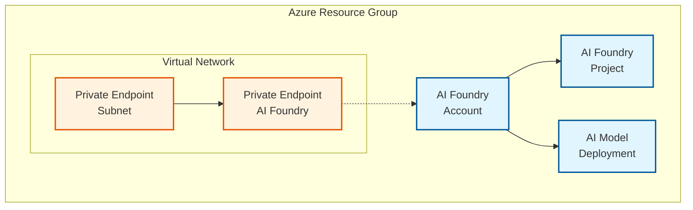

# Private example

This deploys the module with private networking and secure access.

The Windows VM uses the naming module's `virtual_machine_windows` variant for its guest computer name, which is limited to 15 characters. Its Azure resource name uses the separate `compute_virtual_machine` variant.

Local authentication is disabled for the Foundry account and Cosmos DB. The Bastion public IP preserves the Azure-managed `FirstPartyUsage` IP tag when Azure injects it; other IP tags remain managed by Terraform.

## Architecture

This example demonstrates a deployment with private endpoints for secure connectivity:

**Components:**
- AI Foundry Account with GPT-4 model deployment
- AI Foundry Project for development workspace
- Private endpoints for secure network access
- No BYOR services (uses managed AI Foundry services)
